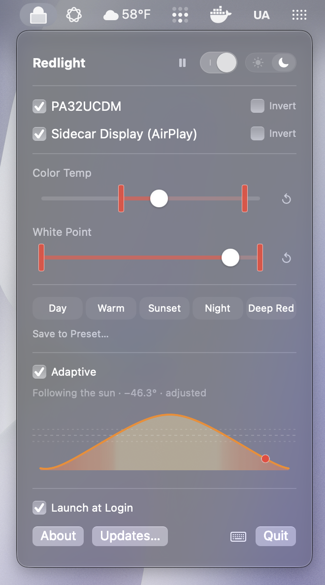
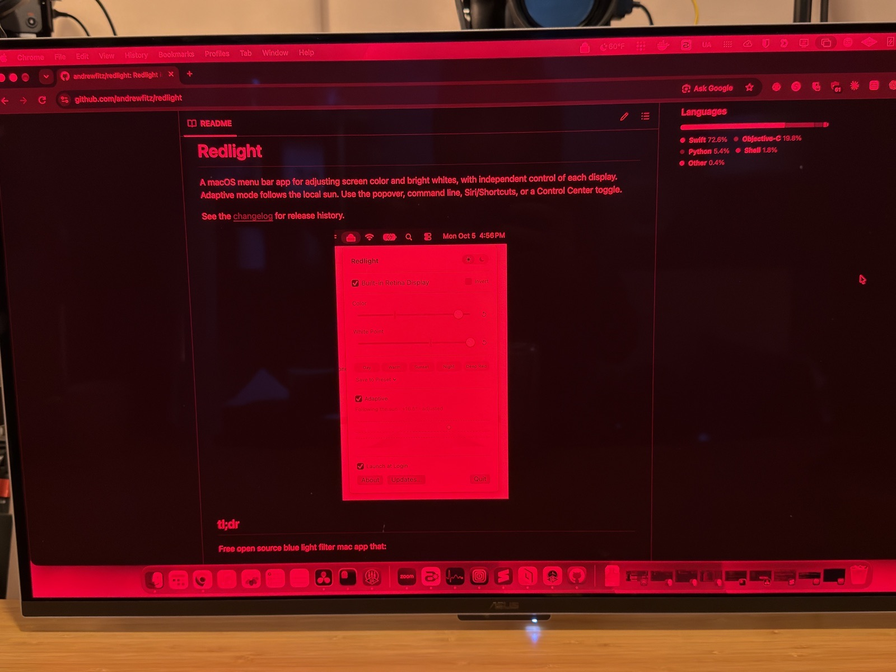

# Redlight

A macOS menu bar app that warms screen color and dims bright whites, with independent control
of each display, including Sidecar iPads. Adaptive mode follows the local sun. Control it from
the popover, keyboard shortcuts, the command line, Siri and Shortcuts, or Control Center.

See the [changelog](CHANGELOG.md) for release history.

<p align="center">
  </p>

## tl;dr

Free open source blue light filter mac app that:
- goes total red (way past Night Shift limits)
- white point reduction
- multi monitor support / disable
- ipad sidecar support
- invert color per monitor
- dark and light mode toggle
- location-aware adaptive circadian rhythm over the day (allow location)
- native gpu accelerated fast, efficient & lightweight
- not janky old archaic code like iris and flux (but props to OGs)
- menu bar only
- command center and shortcut support
- assignable keyboard shortcuts
- cli controllable (ai agent accessible)
- no tracking data sent fully private

## What it does

**Filter**

- **Color Temp** goes from a normal screen (100%) to pure red (0%), passing through warm orange. Blue drops faster than green, so it never turns purple
- **White Point** dims bright areas while leaving darks mostly unchanged, like iOS Reduce White Point but adjustable
- **Presets**: one-click Day, Warm, Sunset, Night and Deep Red. **Save to Preset…** overwrites a preset with the current sliders
- **Invert** per display flips light and dark beneath the red filter

**Adaptive**

- Follows the real sun: warming starts before sunset, passes the golden-hour and twilight markers, reaches deepest red at solar midnight, mirrors back through dawn, and clears within about half an hour of sunrise. Your location never leaves your Mac
- The **sun arc** graphs today's solar elevation, the sun's position, and the filter level Adaptive applies
- **Band limits**: drag the red bracket markers on each slider to set a hard minimum and maximum. Moving a slider inside the band shifts the curve without turning Adaptive off
- **Fixed values**: drag one bracket onto the other to pin that slider, so Adaptive leaves it alone while the other one keeps following the sun. Moving a pinned slider moves the pin; drag a bracket tip (above or below the knob) to pull the limits apart again
- Changes ease in over two seconds. Turning Adaptive off keeps exactly what is on screen as your manual setting

**Displays**

- Turn each display on or off independently. Each one fades in or out over 0.7 seconds, including at launch and quit
- **Sidecar iPads** are filtered automatically with the same controls, and the pointer is tinted too
- Each display's ColorSync calibration is restored when its filter turns off, and on quit

**Controls**

- **Pause** suspends the tint for 30 minutes, with a minutes countdown in the header. Invert stays on
- **Keyboard shortcuts** that work in any app, with no Accessibility or Input Monitoring permission
- **Light/dark switch** for the system appearance
- **Command line**, **Siri and Shortcuts** actions, and a **Control Center** toggle

**App**

- Lives in the menu bar only, with no Dock icon
- Remembers your settings across launches
- Optional **Launch at Login**, off by default and never registered behind your back
- **Automatic updates** through Sparkle, plus an **Updates…** button

## New in 1.4

- **Sidecar support**: iPads are filtered in the Mac's compositor, including the pointer
- **Pause** for 30 minutes from a button beside the main switch
- **Keyboard shortcuts** for on/off, Pause, Warmer/Cooler, White Point, Light/Dark, Adaptive and each preset
- **Command line steps and pause**: `redlight color down 5`, `redlight pause`, `redlight resume`
- **Siri**: “Pause Redlight”, “Resume Redlight”, and “Make Redlight warmer” (or cooler, dimmer, brighter)
- **Smoother sliders**: clicking the track moves the value, and limits no longer stick after release
- **Fixed values under Adaptive**: drag a slider's brackets together to pin it, all the way to 0 or 100%
- The Color slider is now called **Color Temp**

## Using it

Click the menu bar icon (a sun behind a monitor) to open the popover. The icon's screen is
solid while a filter is showing and faint when it is off or paused.

- The header switch turns the filter off everywhere, then back on for the displays you had enabled
- The **pause** button beside it suspends the tint for 30 minutes; click it again to resume early
- Toggle each display, or check **Invert** to flip its colors
- Drag **Color Temp** to remove blue and green light, and **White Point** to reduce peak brightness
- Click a preset to jump to it. The reset button beside each slider restores its default and clears its limits
- Turn on **Adaptive** to let the sun drive the filter, then drag the red brackets to set its limits
- The keyboard button at the bottom opens **Keyboard Shortcuts**

### Pause

Pausing hides the tint without changing which displays are enabled, so Invert stays on. The
header counts down the minutes left, and the filter fades back when the time is up. A pause
survives sleep and relaunch, and changing the clock cannot make it longer than 30 minutes.

While paused, Redlight counts as off: the menu bar icon, Control Center and `redlight status`
all show off. Turning Redlight on, from anywhere, ends the pause. Slider and preset changes
made while paused are saved and appear on resume. Pause is unavailable while Redlight is off.

## Keyboard shortcuts

Open the popover and click the keyboard button. Click a field and press a combination to
assign it. Esc cancels, and Delete or the clear button removes a shortcut.

Nothing is assigned until you choose. **Use Suggested Shortcuts** assigns:

| Action | Shortcut |
| --- | --- |
| Turn Redlight on or off | ⌥⌘R |
| Pause for 30 minutes (hold to peek) | ⌥⌘P |
| Warmer / Cooler | ⌥⌘[ / ⌥⌘] |
| Dimmer / Brighter White Point | ⌥⌘- / ⌥⌘= |
| Toggle Light/Dark Mode | ⌥⌘A |

Toggle Adaptive and each preset can also be assigned.

- **Tap** the Pause shortcut to pause or resume. **Hold** it to see true colors until you let go
- Warmer, Cooler, Dimmer and Brighter move 5% per press and repeat while held, at your system key repeat rate
- A brief readout shows the result on the screen with the pointer, and VoiceOver announces it
- Shortcuts need ⌘ or ⌃ plus another modifier. F13–F19 work on their own, for Stream Deck and similar devices
- Shortcuts macOS already uses are refused. If another app holds a combination, its row says so
- Assigning a shortcut that another action uses moves it to the new action

## Command line

When Redlight runs from `/Applications` or `~/Applications`, it installs a `redlight`
symlink in the first writable directory of `/opt/homebrew/bin` and `/usr/local/bin`.
If neither is writable, opening the popover offers one administrator prompt. Cancelling
leaves the app usable and suppresses future prompts. You can also install the link manually:

```bash
sudo mkdir -p /usr/local/bin
sudo ln -s /Applications/Redlight.app/Contents/MacOS/Redlight /usr/local/bin/redlight
```

Automatic installation never replaces existing files or links to other tools. The link
points to the app executable and stops working if you delete the app.

```bash
redlight on
redlight color 30                # Color Temp, 0–100
redlight whitepoint 50           # 25–100
redlight color down 5            # warmer; steps default to 5
redlight whitepoint up 10
redlight pause                   # 30 minutes
redlight resume
redlight preset night
redlight preset save night
redlight adaptive on
redlight limits color 10 80
redlight limits whitepoint 30 90
redlight limits whitepoint 100 100   # pin White Point: Adaptive only changes Color Temp
redlight display list
redlight display 2 on
redlight display "Studio" invert toggle
redlight display all off
redlight appearance dark
redlight login on
redlight status --json
redlight --version
```

`redlight --help` lists every command, including resets, updates and quit.

- Levels are percentages matching the popover. Display names accept a unique case-insensitive substring
- `color` is the command name for Color Temp. `down` is warmer, and steps start from the current setting
- Applying a preset turns Adaptive off. Setting a level while Adaptive is on shifts its curve within the limits
- `on`, `toggle` and `resume` end a pause. While paused, `status` reports off and the minutes left
- A command that changes settings interrupts a slider drag in progress, so the drag cannot overwrite it

`status`, `off`, `pause` and `quit` leave a stopped app stopped. Other commands launch it
as needed, and `toggle` on a stopped app turns it on. Only one copy of the app can own the
displays; if an older version is running, quit it first.

Add `--json` for script output. Exit codes are `0` for success, `1` for invalid input and
`2` for an unavailable app or failed system action. `login on` reports when approval is
needed in System Settings → Login Items.

## Siri, Shortcuts and Control Center

Redlight provides Shortcuts app actions for its commands, including Pause and Resume,
Adjust (warmer, cooler, dimmer or brighter by any amount), display selection, preset
editing, limits, system appearance and status. These Siri phrases work out of the box:

- “Turn on Redlight” / “Turn off Redlight”
- “Pause Redlight” / “Resume Redlight”
- “Make Redlight warmer” (or cooler, dimmer, brighter), 5% per request
- “Set Redlight to Night” (or another preset)
- “Turn on Redlight Adaptive”

On macOS 26 or later, open **Control Center → Edit Controls → Add Controls**, search for
**Redlight**, and add its toggle. It uses the same master switch and can launch the app.
It shows off while Redlight is paused or has quit, and your display selections are kept
for next time.

## Install

Download the latest `Redlight-<version>.dmg` from [Releases](../../releases), open it, and
drag **Redlight** to `/Applications`. Installed copies update themselves.

If macOS blocks an older release from opening, right-click the app and choose **Open**, or
allow it under **System Settings → Privacy & Security**.

Adaptive asks for Location access the first time you turn it on. The light/dark switch may
ask once for permission to control System Events.

## Building from source

```bash
git clone https://github.com/andrewfitz/redlight.git
cd redlight
./build.sh
```

This produces `Redlight.app` and `Redlight-<version>.dmg` in the repository root. Quit the
running copy before replacing it in `/Applications`. To keep build artifacts elsewhere:

```bash
REDLIGHT_BUILD_OUTPUT_DIR="$PWD/.build/dist" ./build.sh
```

A local build may ask again for Location and Automation permission after each rebuild.

Each build advances its build number automatically. The release version comes from the
[VERSION](VERSION) file, and About shows both, for example `1.4 (58)`. Set `VERSION=1.5`
to override it for one build. CI can set `BUILD_NUMBER` to a positive integer greater than
the previous build; lower or repeated values are rejected. The counter lives in
`.build/redlight-build-number.json` and is seeded from Git history and existing Redlight
bundles, so failed builds may leave gaps.

## Requirements

- A Mac with Apple silicon (there is no Intel build)
- macOS 14 (Sonoma) or later. The Control Center toggle needs macOS 26 or later
- To build: full Xcode.app with a macOS 26 or later SDK

## How it works

Redlight writes each display's gamma lookup table with CoreGraphics
(`CGSetDisplayTransferByTable`), so the GPU applies the filter with no overlay. Red stays
at full brightness while green and blue scale down, blue faster than green, for a warm
orange-to-red transition. White Point applies a transfer curve that concentrates the
reduction on highlights and preserves darks. Invert is the innermost layer of the same
table (`x → 1 − x`). Pause scales only the tint, which is how Invert stays on.

**Sidecar** sends the desktop to the iPad before the gamma tables apply, so Redlight covers
the iPad display with a transparent, click-through WindowServer backdrop instead. Its
per-channel curves reproduce the same color, highlight and inversion math, with no screen
capture, Accessibility permission, or iPad setup. Turning the filter off removes the
backdrop. macOS draws the pointer above every window, so while the pointer is on a filtered
iPad, Redlight hides it and draws the current cursor beneath the backdrop. Two side effects:
the pointer can flash untinted for a moment when the frontmost app changes, and apps cannot
hide it while you type on the iPad. This path uses guarded private Core Animation and
SkyLight calls verified on macOS 27; if a future macOS removes them, the iPad or its pointer
stays unfiltered rather than breaking.

**Adaptive** uses CoreLocation to get an approximate coordinate, caches it for offline use,
refreshes it occasionally and after wake, and computes the sun's elevation locally with the
NOAA solar algorithm. The filter starts easing at +12°, reaches Warm at +6° and Sunset at
0°, follows the civil, nautical and astronomical twilight boundaries at −6°, −12° and −18°,
and reaches Deep Red at solar midnight. Mornings mirror the night up to sunrise, then reach
Day by +4°. Where the sun never sinks to −24° (high-latitude summer), the night is stretched
so its lowest point still reaches Deep Red.

**Keyboard shortcuts** use Carbon's `RegisterEventHotKey`, which receives only the
registered combinations and needs no permissions. Shortcuts, CLI commands, Siri actions
and popover controls all run through one command layer, so they behave identically.

The **light/dark switch** uses a private SkyLight call. If it is unavailable, Redlight falls
back to System Events, which asks for Automation permission once.

## Sidecar performance checks

With Sidecar connected, run `Tools/benchmark-sidecar.sh`. It compiles an optimized,
standalone CPU benchmark with an invisible overlay and reports five samples of 10,000
calls per workload and their median. It does not measure GPU load, transport latency,
or overall system performance. An optional first argument selects an older
`DisplayFilterController.swift` for comparison.

On the development Mac running macOS 27, the optimization audit measured:

| Workload | Before, ms/10,000 calls | After, ms/10,000 calls |
| --- | ---: | ---: |
| Repeated identical window output | 11.40 | 0.60 |
| Changing window output | 11.56 | 11.37 |
| Display routing plus changing window output | 253.22 | 12.04 |

The geometry and color-transfer tests remain the correctness gate. Physical displays still
reapply their gamma tables normally, and the caches are cleared whenever displays change.

## Testing

```bash
swift test
python3 -m unittest discover -s Tools/tests
```

Swift tests cover display behavior with mock gamma, Sidecar routing and pointer handling,
pause and peek, keyboard shortcut validation and dispatch, commands, the parser and
transport, popover and intent parity, slider interaction, installer safeguards, and solar
calculations and chart geometry. Python tests cover release versions, concurrent
build-number allocation, and changelog release notes. `build.sh` verifies both bundles'
metadata, versions, extension entry point, entitlements and code signatures.

## License

MIT
