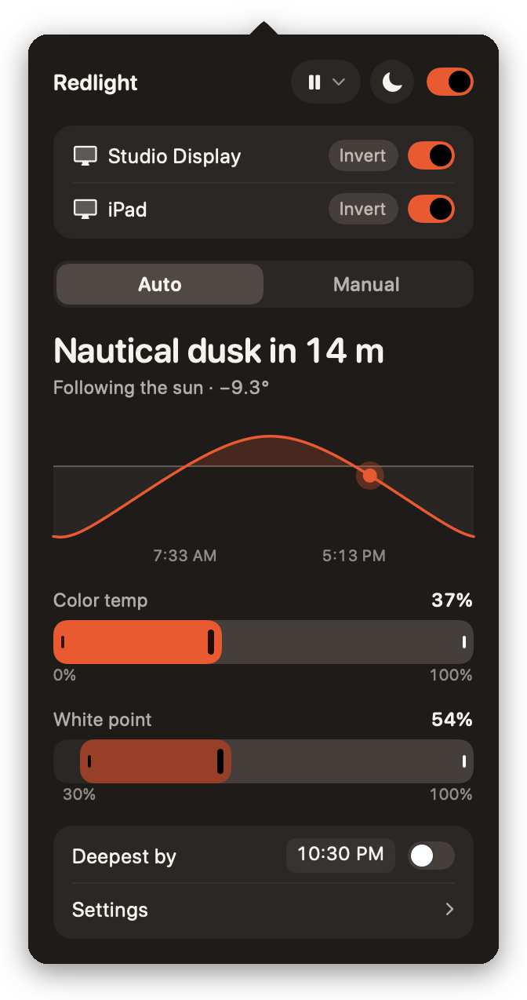

# Redlight

A Mac app that filters and blocks blue light from your screen and reduce brightness without PWM, based on circadian rhythm time of day. Modern alternative to Flux and Iris and Night Shift.

A new macOS menu bar app with independent control of each display, including Sidecar iPads. Adaptive mode follows the local sun. Control it from
the popover, keyboard shortcuts, the command line, Siri and Shortcuts, or Control Center.

See the [changelog](CHANGELOG.md) for release history.

<p align="center">
  </p>

## tl;dr

Free open source blue light filter mac app that:
- goes total red (way past night shift limits)
- white point reduction
- multi monitor support / disable and invert
- ipad sidecar support
- dark and light mode toggle
- location-aware adaptive circadian rhythm over the day (allow location)
- native hardware gpu accelerated: fast, efficient & lightweight
- modern and elegant, not janky old archaic code
- set and forget as a menu/task bar
- command center and shortcut support
- assignable keyboard shortcuts
- cli & command line controllable (ai agent accessible)
- no tracking data sent, fully private

## What it does

**Filter**

- **Color Temp** goes from a normal screen (100%) to pure red (0%), passing through warm orange. Blue drops faster than green, so it never turns purple
- **White Point** dims bright areas while leaving darks mostly unchanged, like iOS Reduce White Point but adjustable
- **Presets**: one-click Day, Warm, Sunset, Night and Deep Red, each fading in over two seconds. **Save to Preset…** overwrites a preset with the current sliders
- **Invert** per display flips light and dark beneath the red filter

**Adaptive**

- Follows the real sun: warming starts before sunset, passes the golden-hour and twilight markers, reaches deepest red at solar midnight, mirrors back through dawn, and clears within about half an hour of sunrise. Your location never leaves your Mac
- The **sun arc** graphs today's solar elevation, the sun's position, and the filter level Adaptive applies
- The status line names the next solar event, such as “Sunset in 1 h 12 m”
- **Deepest by** sets a bedtime: the filter ramps to your deepest setting over the two hours before it, however late the sun sets
- **Manual location**: enter a latitude and longitude instead of granting Location access
- **Band limits**: drag the red bracket markers on each slider to set a hard minimum and maximum. Moving a slider inside the band shifts the curve without turning Adaptive off
- **Fixed values**: set equal limits with the CLI to keep one slider fixed while the other follows the sun. For example, `redlight limits whitepoint 80 80` holds White Point at 80%
- Changes ease in over two seconds. Turning Adaptive off keeps exactly what is on screen as your manual setting

**Displays**

- Turn each display on or off independently. Each one fades in or out over 0.7 seconds, including at launch and quit
- **Sidecar iPads** are filtered automatically with the same controls, and the pointer is tinted too
- Each display's ColorSync calibration is restored when its filter turns off, and on quit

**Controls**

- **Pause** suspends the tint for 30 minutes, with a countdown in the header. Invert stays on. Other lengths, up to 24 hours or until sunrise, are one click away
- **Pause for apps** suspends the tint while an app you choose, such as a photo or video editor, is in front
- **Keyboard shortcuts** that work in any app, with no Accessibility or Input Monitoring permission
- **Light/dark switch** for the system appearance
- **Command line**, **Siri and Shortcuts** actions, and a **Control Center** toggle

**App**

- Lives in the menu bar only, with no Dock icon
- Remembers your settings across launches
- Optional **Launch at Login**, off by default and never registered behind your back
- **Automatic updates** through Sparkle, plus an **Updates…** button

## New in 1.6

- Type coordinates directly into the menu bar popover and press Return to save. On shorter displays, scroll to reach all the controls.
- Adjust a focused slider or band limit with the arrow keys. Drag the center of an existing pinned slider to move its fixed value.
- **Until sunrise** follows the actual sunrise deadline across sleep, relaunch, and clock changes.
- Display fades reuse calibration samples. Global shortcuts and Control Center toggles handle repeated input more reliably.

## New in 1.5

- **Pause for apps**: the tint steps aside while color-critical apps are in front, and returns when you switch away
- **Pause lengths**: 30 minutes, 1 hour, 2 hours or until sunrise from the popover; any length from the command line and Shortcuts
- **Bedtime for Adaptive**: reach your deepest setting by a set time, whatever the sun is doing
- **Manual location** for Macs that cannot get a fix, or if you prefer not to share Location
- **Next solar event** countdown under the Adaptive status
- **Presets fade** over two seconds instead of jumping
- New commands: `redlight pause 90`, `redlight pause until sunrise`, `redlight location`, `redlight adaptive bedtime` and `redlight apps`

## New in 1.4

- **Sidecar support**: iPads are filtered in the Mac's compositor, including the pointer
- **Pause** for 30 minutes from a button beside the main switch
- **Keyboard shortcuts** for on/off, Pause, Warmer/Cooler, White Point, Light/Dark, Adaptive and each preset
- **Command line steps and pause**: `redlight color down 5`, `redlight pause`, `redlight resume`
- **Siri**: “Pause Redlight”, “Resume Redlight”, and “Make Redlight warmer” (or cooler, dimmer, brighter)
- **Smoother sliders**: clicking the track moves the value, and limits no longer stick after release
- **Fixed values under Adaptive**: set equal minimum and maximum limits to pin a value
- The Color slider is now called **Color Temp**

## Using it

Click the menu bar icon (a sun behind a monitor) to open the popover. The icon's screen is
solid while a filter or inversion is showing and faint when both are off.

- The header switch turns the filter off everywhere, then back on for the displays you had enabled
- The **pause** button beside it suspends the tint for 30 minutes; click it again to resume early. The chevron next to it offers 1 hour, 2 hours and Until sunrise
- Toggle each display, or check **Invert** to flip its colors
- Drag **Color Temp** to remove blue and green light, and **White Point** to reduce peak brightness
- Click a preset to jump to it. The reset button beside each slider restores its default and clears its limits
- Turn on **Adaptive** to let the sun drive the filter, then drag the red brackets to set its limits. **Deepest by** and the location fields appear beneath it
- Open **Pause for apps** to choose apps that suspend the tint while they are in front
- The keyboard button at the bottom opens **Keyboard Shortcuts**

### Pause

Pausing hides the tint without changing which displays are enabled, so Invert stays on. The
header counts down the time left, and the filter fades back when the time is up. A pause
survives sleep and relaunch. A fixed-duration pause lasts from 1 minute to 24 hours, and a
clock change cannot extend it beyond the length you chose. **Until sunrise** needs a
location and looks up to 25 hours ahead to allow for changes in sunrise time between days.

While paused, Control Center and `redlight status` show off. The menu bar icon dims once
the fade finishes unless a display still uses Invert. Turning Redlight on ends the pause.
Slider and preset changes made while paused are saved and appear on resume. Pause is unavailable while Redlight is off.

### Pause for apps

Open **Pause for apps** in the popover and add any running app. While a chosen app is in
front, the tint fades out and the header shows “Suspended for” and its name; it fades back
when you switch to another app. Invert stays on, and the menu bar icon goes faint.

Unlike Pause, this does not count as off: Control Center and `redlight status` still show
on, and turning Redlight off and on again while the app is in front leaves the tint
suspended. Pause works independently. Slider, preset and Adaptive changes made meanwhile
appear when the suspension ends.

### Bedtime

With Adaptive on, set a time and check **Deepest by**; to change it later, edit the time and
click **Set**. Starting two hours before it, the
filter eases to the deepest end of your limits and holds there until solar midnight, when
the normal morning curve takes over. Bedtime can only make the evening redder, never
lighter, and the sun arc shows the result. The status line reads “bedtime” while it is in
effect.

A bedtime later than solar midnight (around 01:00 during summer time in many places) has no
effect that night. Under the midnight sun the tint lifts again after solar midnight.

### Location

Adaptive normally uses Location Services, falling back to a city in your time zone. To set
it yourself, enter a latitude and longitude under Adaptive, or run `redlight location`.
With a manual location Redlight makes no Location requests and does not ask for permission.
Switch back to automatic at any time.

## Keyboard shortcuts

Open the popover and click the keyboard button. Click a field and press a combination to
assign it. Esc cancels, and Delete or the clear button removes a shortcut.

Nothing is assigned until you choose. **Use Suggested Shortcuts** assigns:

| Action | Shortcut |
| --- | --- |
| Turn Redlight on or off | ⌥⌘R |
| Pause for 30 minutes (hold to peek) | ⌥⌘P |
| Warmer / Cooler | ⌥⌘[ / ⌥⌘] |
| Dimmer / Brighter White Point | ⌥⌘- / ⌥⌘= |
| Toggle Light/Dark Mode | ⌥⌘A |

Toggle Adaptive and each preset can also be assigned.

- **Tap** the Pause shortcut to pause or resume. **Hold** it to see true colors until you let go
- Warmer, Cooler, Dimmer and Brighter move 5% per press and repeat while held, at your system key repeat rate
- A brief readout shows the result on the screen with the pointer, and VoiceOver announces it
- Shortcuts need ⌘ or ⌃ plus another modifier. F13–F19 work on their own, for Stream Deck and similar devices
- Shortcuts macOS already uses are refused. If another app holds a combination, its row says so
- Assigning a shortcut that another action uses moves it to the new action

## Command line

When Redlight runs from `/Applications` or `~/Applications`, it installs a `redlight`
symlink in the first writable directory of `/opt/homebrew/bin` and `/usr/local/bin`.
If neither is writable, opening the popover offers one administrator prompt. Cancelling
leaves the app usable and suppresses future prompts. You can also install the link manually:

```bash
sudo mkdir -p /usr/local/bin
sudo ln -s /Applications/Redlight.app/Contents/MacOS/Redlight /usr/local/bin/redlight
```

Automatic installation never replaces existing files or links to other tools. The link
points to the app executable and stops working if you delete the app.

```bash
redlight on
redlight color 30                # Color Temp, 0–100
redlight whitepoint 50           # 25–100
redlight color down 5            # warmer; steps default to 5
redlight whitepoint up 10
redlight pause                   # 30 minutes
redlight pause 90                # minutes, 1–1440
redlight pause until sunrise
redlight resume
redlight preset night
redlight preset save night
redlight adaptive on
redlight adaptive bedtime 22:30  # or: off
redlight location 51.5 -0.12     # or: auto
redlight limits color 10 80
redlight limits whitepoint 30 90
redlight limits whitepoint 100 100   # pin White Point: Adaptive only changes Color Temp
redlight display list
redlight display 2 on
redlight display "Studio" invert toggle
redlight display all off
redlight apps add com.adobe.Photoshop
redlight apps list               # also: remove <bundle-id>, clear
redlight appearance dark
redlight login on
redlight status --json
redlight --version
```

`redlight --help` lists every command, including resets, updates and quit.

- Levels are percentages matching the popover. Display names accept a unique case-insensitive substring
- `color` is the command name for Color Temp. `down` is warmer, and steps start from the current setting
- Applying a preset turns Adaptive off and fades over two seconds. Setting a level while Adaptive is on shifts its curve within the limits
- `on`, `toggle` and `resume` end a pause. While paused, `status` reports off and the minutes left
- `pause <minutes>` while already paused replaces the running pause
- `apps` takes bundle identifiers. `status` adds “suspended for” and the app's name while a chosen app is in front, and still reports on
- `status --json` reports the location source (`auto`, `manual` or `timeZone`), never the coordinates
- A command that changes settings interrupts a slider drag in progress, so the drag cannot overwrite it

`status`, `off`, `pause` (with or without a length) and `quit` leave a stopped app stopped.
Other commands launch it as needed, and `toggle` on a stopped app turns it on. Only one
copy of the app can own the displays; if an older version is running, quit it first. The
`redlight` command and the running app must be the same version, or the command asks you
to update.

Add `--json` for script output. Exit codes are `0` for success, `1` for invalid input and
`2` for an unavailable app or failed system action. `login on` reports when approval is
needed in System Settings → Login Items.

## Siri, Shortcuts and Control Center

Redlight provides Shortcuts app actions for its commands, including Pause (with an optional
length, or until sunrise) and Resume, Adjust (warmer, cooler, dimmer or brighter by any
amount), display selection, preset editing, limits, bedtime, location, pause for apps,
system appearance and status. These Siri phrases work out of the box:

- “Turn on Redlight” / “Turn off Redlight”
- “Pause Redlight” / “Resume Redlight”
- “Make Redlight warmer” (or cooler, dimmer, brighter), 5% per request
- “Set Redlight to Night” (or another preset)
- “Turn on Redlight Adaptive”

On macOS 26 or later, open **Control Center → Edit Controls → Add Controls**, search for
**Redlight**, and add its toggle. It uses the same master switch and can launch the app.
It shows off while Redlight is paused or has quit, and your display selections are kept
for next time.

## Install

Download the latest `Redlight-<version>.dmg` from [Releases](../../releases), open it, and
drag **Redlight** to `/Applications`. Installed copies update themselves.

If macOS blocks an older release from opening, right-click the app and choose **Open**, or
allow it under **System Settings → Privacy & Security**.

Adaptive asks for Location access the first time you turn it on, unless you have set a
manual location. The light/dark switch may ask once for permission to control System Events.

## Building from source

```bash
git clone https://github.com/andrewfitz/redlight.git
cd redlight
./build.sh
```

This produces `Redlight.app` and `Redlight-<version>.dmg` in the repository root. Quit the
running copy before replacing it in `/Applications`. To keep build artifacts elsewhere:

```bash
REDLIGHT_BUILD_OUTPUT_DIR="$PWD/.build/dist" ./build.sh
```

A local build may ask again for Location and Automation permission after each rebuild.

Each build advances its build number automatically. The release version comes from the
[VERSION](VERSION) file, and About shows both, for example `1.4 (58)`. Set `VERSION=1.5`
to override it for one build. CI can set `BUILD_NUMBER` to a positive integer greater than
the previous build; lower or repeated values are rejected. The counter lives in
`.build/redlight-build-number.json` and is seeded from Git history and existing Redlight
bundles, so failed builds may leave gaps.

The release script packages the current Git commit and uses its source, changelog, and
locked dependencies. Commit any changes you want included before running the release script.

## Requirements

- A Mac with Apple silicon (there is no Intel build)
- macOS 14 (Sonoma) or later. The Control Center toggle needs macOS 26 or later
- To build: full Xcode.app with a macOS 26 or later SDK

**Adaptive** uses CoreLocation to get an approximate coordinate (or the one you entered),
caches it for offline use, refreshes it hourly and after wake, and computes the sun's elevation locally with the
NOAA solar algorithm. The filter starts easing at +12°, reaches Warm at +6° and Sunset at
0°, follows the civil, nautical and astronomical twilight boundaries at −6°, −12° and −18°,
and reaches Deep Red at solar midnight. Mornings mirror the night up to sunrise, then reach
Day by +4°. Where the sun never sinks to −24° (high-latitude summer), the night is stretched
so its lowest point still reaches Deep Red.

## Testing

```bash
swift test
python3 -m unittest discover -s Tools/tests
```

To exercise keyboard entry in a native popover, run the following in a logged-in macOS
session. The test opens a temporary popover backed by simulated displays.

```bash
REDLIGHT_TEST_POPOVER_KEYBOARD=1 swift test --filter PopoverKeyboardSmokeTests
```

Swift tests cover display behavior with mock gamma, Sidecar routing and pointer handling,
pause and peek, pause for apps, bedtime, manual location, keyboard shortcut validation and dispatch, commands, the parser and
transport, popover and intent parity, slider interaction, installer safeguards, and solar
calculations and chart geometry. Python tests cover release versions, concurrent
build-number allocation, and changelog release notes. `build.sh` verifies both bundles'
metadata, versions, extension entry point, entitlements and code signatures.

## License

MIT
