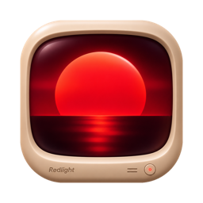
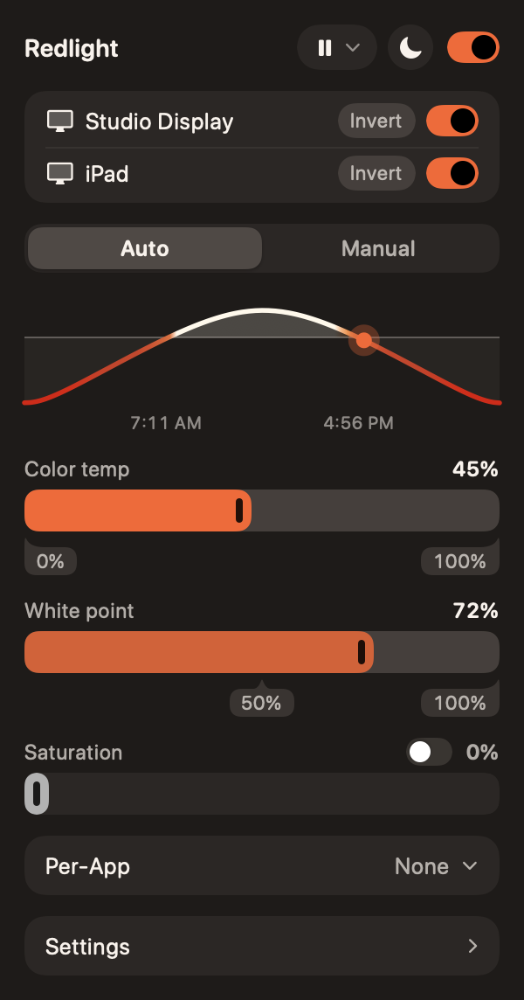
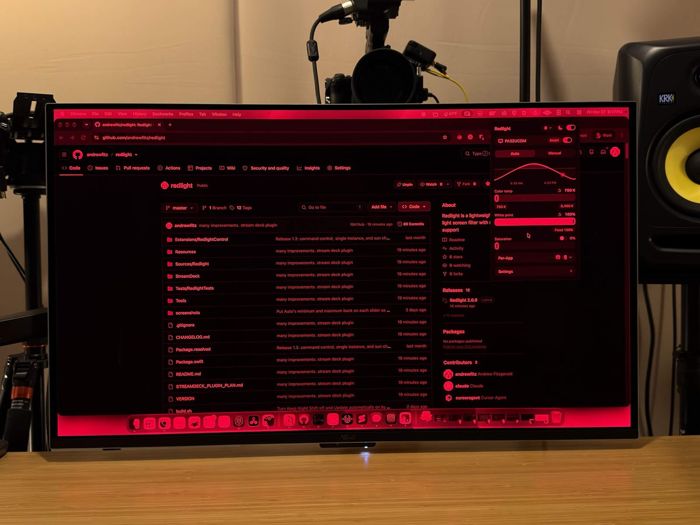

<p align="center">
  
</p>

<h1 align="center">Redlight</h1>

<p align="center">
  <strong>Filters blue light and dims your Mac's screens without PWM, following the circadian rhythm of your day.</strong><br>
  A modern alternative to f.lux, Iris and Night Shift.
</p>

<p align="center">
  <a href="../../releases/latest"><strong>Download</strong></a> ·
  <a href="#tldr">Features</a> ·
  <a href="CHANGELOG.md">Changelog</a>
</p>

A macOS menu bar app with independent control of each display, including Sidecar iPads. Auto follows the local sun. Control it from
the popover, keyboard shortcuts, the command line, Siri and Shortcuts, Control Center or a Stream Deck.

The tint never shows up in screenshots, screen recordings or screen sharing: they keep your
screen's true colours (see [Screenshots, recordings and screen sharing](#screenshots-recordings-and-screen-sharing)).

<p align="center"><picture><source media="(prefers-color-scheme: light)" srcset="screenshots/popover-light.png"></picture>
  </p>

## tl;dr

Free open source blue light filter mac app that:
- goes total red (way past Night Shift limits)
- white point reduction (dim without flickering)
- b&w grayscale and saturation control
- location-aware adaptive circadian rhythm over the day
- adapts to your preferences over time
- stream deck plugin
- pause countdown and peek
- per-app settings
- multi monitor support / disable
- ipad sidecar support
- invert color per monitor
- monitor color profile calibrated kelvin units
- dark and light mode toggle
- native gpu accelerated: fast, efficient & lightweight
- modern design vs Iris and f.lux
- menu bar only
- control center and shortcut support
- assignable keyboard shortcuts
- cli controllable (ai agent accessible)
- invisible to screenshots, screen recording and screen sharing
- no tracking data sent, fully private

## What it does

**Filter**

- **Color Temp** goes from a normal screen (100%) to pure red (0%), passing through warm orange. Blue drops faster than green, so it never turns purple. Show it as a percent or in kelvin: 100% is your display's own white, D65 or about 6,500 K on a standard or Apple display
- **White Point** dims bright areas while leaving darks mostly unchanged, like iOS Reduce White Point but adjustable. It runs from 100% (no reduction) to 0%, the strongest reduction Redlight allows, which still leaves a quarter of the white point so the screen stays readable
- **Saturation** takes colour out of the screen, down to grayscale at 0%, before the red filter and White point. It has its own switch and is off until you turn it on
- **Presets**: one-click Day, Warm, Sunset, Night and Late, each fading in over two seconds. In Manual, **Save to a preset…** overwrites a preset with the current sliders
- **Invert** per display flips light and dark beneath the red filter
- **Not captured**: screenshots, screen recordings and screen sharing show your true colours, not the tint

**Adaptive**

- Follows the real sun: warming starts before sunset, passes the golden-hour and twilight markers, reaches deepest red at solar midnight, mirrors back through dawn, and clears within about half an hour of sunrise. Your location never leaves your Mac
- The **sun arc** graphs today's solar elevation and the sun's position, with sunrise and sunset times and your bedtime. It is drawn in the tint Auto will show at each time of day, as bright as White Point will be then
- **Learn my adjustments**, in Settings and on by default: Auto learns how you set each slider at each time of day and starts doing it for you, ignores big one-off changes, and moves the limit flags to where you leave them
- **Deepest by**, in Settings, sets a bedtime: the filter ramps to your deepest setting over the two hours before it, however late the sun sets
- **Clear by**, in Settings, sets a wake time: the filter is back at its clearest by then, however late the sun rises, and a bedtime holds through the night until it
- Works at any latitude: under the midnight sun and through the polar night the curve still reaches Day at solar noon and Late at solar midnight
- **Manual location**: enter a latitude and longitude in Settings instead of granting Location access
- **Limits**: in Auto, each slider shows its minimum and maximum as labelled flags under the track. Drag a flag to set a hard limit; the screen previews it while you drag. Moving a slider shifts the curve without leaving Auto, and dragging past a flag moves the flag with you, so 0% and 100% are always reachable
- **Fixed values**: drag one flag onto the other and they merge into a single “Fixed” flag, which keeps that slider fixed while the other follows the sun. The flags otherwise keep the limits at least 5% apart. Drag the merged flag to either side to open the range again. From the CLI, `redlight limits whitepoint 80 80` does the same
- Changes ease in over two seconds. Turning Adaptive off keeps exactly what is on screen as your manual setting

**Displays**

- Turn each display on or off independently. Each one fades in or out over 0.7 seconds, including at launch and quit
- **Sidecar iPads** are filtered automatically with the same controls, and the pointer is tinted too
- Each display's ColorSync calibration is restored when its filter turns off, and on quit

**Controls**

- **Pause** suspends the tint for 30 minutes, with the time left counting down in the Pause button. Invert stays on. Other lengths, up to 24 hours or until sunrise, are one click away
- **Per-App**: a rule for each app you choose, while it is in front. **Pause** hides the tint for a photo or video editor, **Hold** keeps one setting of its own, **Shift** makes it a little warmer or cooler than the rest
- **Keyboard shortcuts** that work in any app, with no Accessibility or Input Monitoring permission
- **Light/dark switch** for the system appearance
- **Command line**, **Siri and Shortcuts** actions, a **Control Center** toggle and a **Stream Deck** plugin

**App**

- Lives in the menu bar only, with no Dock icon
- Remembers your settings across launches
- **Launch at Login**, on for a new install in Applications (switch it off in Settings and it stays off)
- **Automatic updates** through Sparkle, plus **Check for updates** in Settings

## New in 2.0

- **Redesign**: a new popover, a setting-sun menu bar icon that shows how deep the filter is, a new app icon, the same colours in light and dark, and slides between Auto, Manual and Settings that stay smooth on fast displays
- **Saturation**: take colour out of the screen, down to grayscale
- **Kelvin**: show Color Temp as the colour temperature your display actually shows, calibrated to its colour profile, and set it as `redlight color 3400K`
- **Per-App** rules on the popover: Pause, Hold or Shift the tint while an app is in front
- **Learn my adjustments**: Auto learns how you set each slider at each time of day
- **Clear by**: a wake time for Auto, alongside Deepest by
- **Keep Night Shift off**, so the two tints do not stack
- **Stream Deck** plugin with Toggle, Pause / Peek, Preset, Adjust and Status keys
- White Point now runs from 0 to 100%, and Auto works at any latitude

See the [changelog](CHANGELOG.md) for everything, and for earlier releases.

## Using it

Click the menu bar icon (a setting sun) to open the popover. The sun is whole when there is
no filter to show: when Redlight is off, when Color temp is at 100%, and when only Invert is
showing. From 99% down it has one line across it, from 66% two, and from 33% three. Under the lines is the sea, drawn faded: with each line the sun above is a little
smaller and the sea a little wider, like a sun going down over the water.

- The header switch turns the filter off everywhere, then back on for the displays you had enabled
- Your displays are listed at the top: switch each one on or off, and click **Invert** to flip its colors
- Choose **Auto** to let the sun drive the filter, or **Manual** to hold a setting
- In **Auto**, the sun arc shows the day. Drag **Color Temp** to remove blue and green light and **White Point** to reduce peak brightness. Press anywhere on a slider to set it there; drag to either end for exactly 0% or 100%. The flags under each slider are Auto's minimum and maximum: drag one to change it, or onto the other to fix the slider at one value
- The sliders are filled with the color they set: Color Temp from white at 100% to red at 0%, and White Point in the same color, dimmer and less vivid the lower it goes. Light and dark appearance use the same colors
- **Saturation**, under White Point, has its own switch: turn it on, then drag toward 0% for less color, down to grayscale
- In **Manual**, click a preset to jump to it, or drag the sliders. **Save to a preset…** turns the presets into overwrite targets
- A reset button (a circular arrow) appears beside a slider's value when it differs from the default; it restores the value and clears its limits
- The **pause** button beside the header switch suspends the tint for 30 minutes and turns into a play button that resumes it. Its chevron offers 1 hour, 2 hours and Until sunrise
- The moon or sun button beside it switches the system appearance
- **Per-App**, above Settings, shows the icons of the apps with a rule. Click it to change their rules or add another app
- **Settings** at the bottom opens Deepest by, Clear by, Learn my adjustments, location for Auto, **Show color temp as** % or K, Launch at login, Update automatically, Keep Night Shift off, Keyboard shortcuts, updates, About and Quit. It says **Update available** when an update is waiting, and shows a dot when a login item needs approval
- Press Tab to move between controls, the arrow keys to adjust a focused slider (Shift for 10% steps, Home and End for the ends), and Esc to close the popover

### Pause

Pausing hides the tint without changing which displays are enabled, so Invert stays on. The
header counts down the time left, and the filter fades back when the time is up. A pause
survives sleep and relaunch. A fixed-duration pause lasts from 1 minute to 24 hours, and a
clock change cannot extend it beyond the length you chose. **Until sunrise** needs a
location and looks up to 25 hours ahead to allow for changes in sunrise time between days.

While paused, Control Center and `redlight status` show off. The menu bar icon becomes the
whole sun once the fade finishes. Turning Redlight on ends the pause.
Slider and preset changes made while paused are saved and appear on resume. Pause is unavailable while Redlight is off.

### Saturation

**Saturation** sits under White Point with a switch of its own. Turn it on and drag the
slider toward 0% to take colour out of everything on the screen, down to grayscale; 100% is
full colour. It works before the red filter and White Point, so a grayscale screen is then
tinted like any other. Turning the switch off keeps the level for next time. From the
command line: `redlight saturation on`, `redlight saturation 40`, `redlight saturation down 10`.

### Color temp in kelvin

Under **Units** in Settings, **Show color temp as** switches Color Temp and its limit flags
between a percent and kelvin. Kelvin is worked out for your display, not looked up in a table: Redlight
takes the colour it sends the display at each setting through the display's own ColorSync
profile and finds the nearest colour temperature on the blackbody curve. 100% is the
display's own white, which is D65, about 6,500 K, on standard and Apple displays. 0% is the
display's red primary, near the curve's red end: about 990 K on an sRGB display, 820 K on
Display P3 and lower on wider-gamut displays. The command line takes kelvin too
(`redlight color 3400K`, `redlight limits color 1200K 5000K`), and `redlight status` shows
it beside the percent.

### Per-App

Open **Per-App** on the popover, above Settings, and add any running app; it starts with
**Pause**. Pick its rule beside its name:

- **Pause**: the tint fades out while the app is in front, and the header shows “Off for”
  and its name. Invert stays on and the menu bar icon becomes the whole sun. Unlike Pause in
  the header, this does not count as off: Control Center and `redlight status` still show on,
  and turning Redlight off and on again while the app is in front leaves the tint hidden.
- **Hold**: the app gets a Color temp and White point of its own, whatever Auto or Manual
  is doing. Settings shows both values, each with − and + in steps of 5%.
- **Shift**: a signed amount is added to whatever Auto or Manual shows, so the app follows
  the sun a little warmer or cooler than everything else. In Auto it stays inside the limit
  flags, and a Fixed slider is left alone.

Color temp, white point, and saturation use whole percentages in the sliders, saved presets,
per-app rules, CLI status, and Shortcuts. Fractional CLI inputs and settings from older
versions round to the nearest whole percent. Auto and display fades interpolate smoothly.

In either rule, lower **Saturation** below 100% to apply it while the app is in front.
Set it back to 100% to follow global saturation. For grayscale in just one app, choose
Shift, leave Color temp and White point at 0, and set Saturation to 0%. The Shift editor
shows the resulting level and saves the difference from the current global level. The CLI
and Shortcuts accept that difference directly in percentage points.

Switching to or from an app with a rule fades in 0.4 seconds from what is on screen, however
quickly you switch. Pause in the header, a held Pause shortcut (peek) and Off still win: a
peek always shows the screen with no tint. A rule applies to the displays that are on, as
Pause does.

Open the popover while an app with a Hold or Shift is in front, and the line above the
sliders says so, for example “Photoshop: Hold”: the sliders now set that app's rule. Choose
**Edit Auto instead** (or Edit Manual instead) to set Auto or Manual; if the app quits, the
sliders go back to them. The Warmer, Cooler, Dimmer and Brighter keyboard shortcuts change
the rule of the app in front too, since a change to Auto would not show under a Hold. The
command line and Shortcuts never depend on the app in front: `redlight color 40` changes
Auto or Manual, and a rule changes only with `redlight apps set`.

Changes to Auto or Manual made while an app with a Pause or Hold is in front are kept, and
show when you switch away; under a Shift they show at once, shifted.

### Bedtime

At the top of Settings, set a time and turn on **Deepest by**; to change it later, edit the
time and click **Set**. Starting two hours before it, the
filter eases to the deepest end of your limits and holds there until solar midnight, when
the normal morning curve takes over. Bedtime can only make the evening redder, never
lighter. While a bedtime applies, the sun arc marks it with a moon.

A bedtime later than solar midnight (around 01:00 during summer time in many places) has no
effect that night unless a wake time is set, and the popover does not show it as active.

### Wake time

Under Deepest by, set a time and turn on **Clear by**. Over the hour before it the filter
eases back to the clear end of your limits and stays there until solar noon, when the
normal evening curve takes over. It can only make the morning clearer, never redder, so a
dark winter morning no longer starts red.

With Clear by on, Deepest by holds through the night until the wake time instead of
lifting from solar midnight, and a bedtime after solar midnight counts, as long as it is at
least an hour before the wake time. A wake time must fall between solar midnight and solar
noon; one outside that has no effect.

### Learning

**Learn my adjustments** in Settings, on by default, lets Auto learn how you like each
slider at each time of day. With it on, a slider change in Auto belongs to the part of the
sun's day you made it in.
Go redder around sunset on a few evenings and that stretch of the curve stays redder, while
midday is left alone. Because it follows the sun and not the clock, it moves with the
seasons and with you to another time zone.

- The first change you make still moves the whole curve, as it does without learning.
- Where Auto already knows your habit (you have sat through that part of the day on four
  days or more), a change of more than 8% has to be made on two days to stick. A guest's
  change or a film night is gone the next morning. A smaller change is kept at once.
- The limit flags under the sliders follow where you leave the sliders at midday and late at
  night. Leave
  Color temp at 90% by day and the max flag moves to 90%: in Auto it then never goes higher.
  A flag you drag yourself always wins, and pushing the slider past a learned flag lifts it.
- Only time at the screen counts: not while the tint is paused, an app with a Pause or Hold
  is in front, the screen is asleep or locked, or nothing has been typed or moved for ten
  minutes. Time in an app with a Shift counts as if the shift were not there, and changing a
  rule is never learned.
- What was learned is applied overnight, at 04:00 or the next time nobody is at the screen
  (asleep, locked, or half an hour with no input and no video playing), so the picture does
  not change in front of you. The one exception: if someone is there the whole time, the
  day closes anyway once it is 12 hours past its 04:00.

Settings draws what was learned: a line for each slider through the twelve parts of the day,
over a faint line for Auto's own curve, with a dot filled where that part of the day was
learned. `redlight status` and the Shortcuts status say it in a sentence for each slider.
**Reset learning** asks first, then forgets both sliders' learning and keeps your limits;
the reset button beside a slider forgets that slider's learning as well. Neither deletes it:
the last five resets are kept, and `redlight learn restore` brings back the newest (run it
again to undo the restore). The sun arc is drawn in
the tint and brightness Auto will show through the day, so a learned evening or a moved
limit shows there too.

### Night Shift

Night Shift adds its own tint on top of Redlight's. **Keep Night Shift off** in Settings,
on by default, turns Night Shift off whenever it comes on while Redlight is running. Its
schedule is not changed, so it returns at its next start once the switch is off. The switch is shown on
Macs whose display supports Night Shift. It uses a private macOS interface and disappears
on a macOS version that changes it.

### Location

Adaptive normally uses Location Services, falling back to the principal city of your time zone. A location fix is followed while the Mac stays on the UTC offset it was taken in; after a move to another time zone Redlight follows that zone's city until a new fix arrives. **Location for Auto** in Settings names the source: Automatic, Time zone, Last known or Manual. To set
it yourself, choose **Coordinates** under Location for Auto in Settings and enter a latitude
and longitude, or run `redlight location`.
With a manual location Redlight makes no Location requests and does not ask for permission.
Switch back to automatic at any time.

## Keyboard shortcuts

Open Settings in the popover and click **Keyboard shortcuts**. Click a field and press a combination to
assign it. Esc cancels, and Delete or the clear button removes a shortcut.

Nothing is assigned until you choose. **Use Suggested Shortcuts** assigns:

| Action | Shortcut |
| --- | --- |
| Turn Redlight on or off | ⌥⌘R |
| Pause for 30 minutes (hold to peek) | ⌥⌘P |
| Warmer / Cooler | ⌥⌘[ / ⌥⌘] |
| Dimmer / Brighter White Point | ⌥⌘- / ⌥⌘= |
| Toggle Light/Dark Mode | ⌥⌘A |

Toggle Adaptive and each preset can also be assigned.

- **Tap** the Pause shortcut to pause or resume. **Hold** it to see true colors until you let go
- Warmer, Cooler, Dimmer and Brighter move 5% per press and repeat while held, at your system key repeat rate
- A brief readout shows the result on the screen with the pointer, and VoiceOver announces it
- Shortcuts need ⌘ or ⌃ plus another modifier. F13–F19 work on their own, for Stream Deck and similar devices
- Shortcuts macOS already uses are refused. If another app holds a combination, its row says so
- Assigning a shortcut that another action uses moves it to the new action

## Command line

When Redlight runs from `/Applications` or `~/Applications`, it installs a `redlight`
symlink in the first writable directory of `/opt/homebrew/bin` and `/usr/local/bin`.
If neither is writable, opening the popover offers one administrator prompt. Cancelling
leaves the app usable and suppresses future prompts. You can also install the link manually:

```bash
sudo mkdir -p /usr/local/bin
sudo ln -s /Applications/Redlight.app/Contents/MacOS/Redlight /usr/local/bin/redlight
```

Automatic installation never replaces existing files or links to other tools. The link
points to the app executable and stops working if you delete the app.

```bash
redlight on
redlight color 30                # Color Temp, 0–100
redlight color 3400K             # or as a colour temperature, on the first tinted display
redlight whitepoint 50           # 0–100; 0 is the strongest reduction Redlight allows
redlight saturation 0             # 0–100; 0 is grayscale, 100 is full color
redlight color down 5            # warmer; steps default to 5
redlight whitepoint up 10
redlight saturation on           # apply the saved level (off by default)
redlight saturation up 10
redlight peek on                 # true colours for a few seconds, as holding Pause does; peek renew keeps them, peek off ends it
redlight pause                   # 30 minutes
redlight pause 90                # minutes, 1–1440
redlight pause until sunrise
redlight resume
redlight preset night
redlight preset save night
redlight adaptive on
redlight adaptive bedtime 22:30  # or: off
redlight adaptive wake 07:00     # or: off
redlight learn on                # or: off, toggle, reset, restore
redlight location 51.5 -0.12     # or: auto
redlight limits color 10 80
redlight limits color 1200K 5000K    # Color Temp limits in kelvin
redlight limits whitepoint 30 90
redlight limits whitepoint 100 100   # pin White Point: Adaptive only changes Color Temp
redlight display list
redlight display 2 on
redlight display "Studio" invert toggle
redlight display all off
redlight apps set com.apple.FinalCut pause
redlight apps set com.adobe.Photoshop hold 85 90
redlight apps set com.apple.Safari shift -10 0
redlight apps set com.apple.Preview shift 0 0 -100  # grayscale, keeping the current warmth and white point
redlight apps list               # also: remove <bundle-id>, clear
redlight appearance dark
redlight login on
redlight status --json
redlight --version
```

`redlight --help` lists every command, including resets, updates and quit.

- Levels are percentages matching the popover. Display names accept a unique case-insensitive substring
- `color` is the command name for Color Temp. `down` is warmer, and steps start from the current setting
- Applying a preset turns Adaptive off and fades over two seconds. Setting a level while Adaptive is on shifts its curve within the limits
- `on`, `toggle` and `resume` end a pause. While paused, `status` reports off and the minutes left
- `pause <minutes>` while already paused replaces the running pause
- `apps` takes bundle identifiers. `hold` takes Color temp then White point, 0 to 100; `shift` takes them signed, −100 to 100. Both take an optional third number for saturation. `apps list` prints one app per line, its bundle ID first. While an app with a rule is in front, the status line of `status` ends with its name and rule, such as “ · Photoshop: hold”, and `status` still reports on; `status --json` has it as `activeApp`, and every rule as `appRules`
- `color`, `whitepoint` and `saturation` and their steps change Auto or Manual, never an app's rule. Saturation runs from grayscale at 0% to full color at 100%, before the red filter and white point. In `status`, `set` is that value and `target` what the displays are given, an app's Hold or Shift included
- `status --json` reports the location source (`auto`, `manual` or `timeZone`), never the coordinates
- `status --json` reports learning as `enabled`, the parts of the day learned (`anchors`, and `colorAnchors` and `whitepointAnchors` for each slider) `summary`, a sentence for each slider, and `backups`, the resets `learn restore` can bring back
- A command that changes settings interrupts a slider drag in progress, so the drag cannot overwrite it

`status`, `off`, `pause` (with or without a length) and `quit` leave a stopped app stopped.
Other commands launch it as needed, and `toggle` on a stopped app turns it on. Only one
copy of the app can own the displays; if an older version is running, quit it first. The
`redlight` command and the running app must be the same version, or the command asks you
to update.

Add `--json` for script output. Exit codes are `0` for success, `1` for invalid input and
`2` for an unavailable app or failed system action. `login on` reports when approval is
needed in System Settings → Login Items.

## Siri, Shortcuts and Control Center

Redlight provides Shortcuts app actions for its commands, including Pause (with an optional
length, or until sunrise) and Resume, Adjust (warmer, cooler, dimmer or brighter by any
amount, including more or less color), direct saturation control, display selection, preset editing, limits, bedtime, wake time, learning, location,
app rules (Set, Remove, List and Clear Redlight App Rules), system appearance and status. These Siri phrases work out of the box:

- “Turn on Redlight” / “Turn off Redlight”
- “Pause Redlight” / “Resume Redlight”
- “Make Redlight warmer” (or cooler, dimmer, brighter), 5% per request
- “Set Redlight to Night” (or another preset)
- “Turn on Redlight Adaptive”

On macOS 26 or later, open **Control Center → Edit Controls → Add Controls**, search for
**Redlight**, and add its toggle. It uses the same master switch and can launch the app.
It shows off while Redlight is paused or has quit, and your display selections are kept
for next time.

## Stream Deck

The Stream Deck plugin is in [`StreamDeck/`](StreamDeck). Double-click
`StreamDeck/dist/com.redlight.app.streamdeck.streamDeckPlugin` to install it in the Stream
Deck app (7.1 or later, on macOS 14 or later), then drag Redlight's actions onto keys:

- **Toggle Redlight**: on or off; the key shows the state and the current values
- **Pause / Peek**: tap to pause or resume; hold to see true colours until you let go, like
  the Pause shortcut
- **Redlight Preset**: Day, Warm, Sunset, Night or Late, chosen in the key's settings
- **Adjust Redlight**: Color Temp or White Point by a set step per press; on Stream Deck +,
  turn a dial to adjust and press it to reset
- **Redlight Status**: a live readout of Color Temp (in kelvin where it has one), White Point,
  Auto, Pause and the app in front

It works through the `redlight` command, so the command line must be installed (see
[Command line](#command-line)). To build it: `cd StreamDeck && npm install && npm run build && npm run pack`.

## Screenshots, recordings and screen sharing

The tint is not in the picture other apps get of your screen. On a monitor or a Mac's own
screen, Color Temp, White Point and Invert live in the display's gamma table, which turns
pixels into light after macOS has composed the screen, after anything that captures it.
Saturation's grayscale pass is drawn in a window that macOS leaves out of every capture. So
screenshots, screen recordings, screen sharing and video calls show your true colours, while
you see the tint.

The one exception is a **Sidecar iPad**: its picture is the captured screen itself, so its
tint is drawn into that picture, and a capture of the iPad's screen shows it.

## Install

With [Homebrew](https://brew.sh):

```bash
brew install --cask andrewfitz/tap/redlight
```

Or download the latest `Redlight-<version>.dmg` from [Releases](../../releases), open it, and
drag **Redlight** to `/Applications`. Either way it is signed and notarized, and installed
copies update themselves.

If macOS blocks an older release from opening, right-click the app and choose **Open**, or
allow it under **System Settings → Privacy & Security**.

Adaptive asks for Location access the first time you turn it on, unless you have set a
manual location. The light/dark switch may ask once for permission to control System Events.

## Building from source

```bash
git clone https://github.com/andrewfitz/redlight.git
cd redlight
./build.sh
```

This produces `Redlight.app` and `Redlight-<version>.dmg` in the repository root. Quit the
running copy before replacing it in `/Applications`. To keep build artifacts elsewhere:

```bash
REDLIGHT_BUILD_OUTPUT_DIR="$PWD/.build/dist" ./build.sh
```

A local build may ask again for Location and Automation permission after each rebuild.

Each build advances its build number automatically. The release version comes from the
[VERSION](VERSION) file, and About shows both, for example `2.0.0 (127)`. Set `VERSION=2.0.1`
to override it for one build. CI can set `BUILD_NUMBER` to a positive integer greater than
the previous build; lower or repeated values are rejected. The counter lives in
`.build/redlight-build-number.json` and is seeded from Git history and existing Redlight
bundles, so failed builds may leave gaps.

The release script packages the current Git commit and uses its source, changelog, and
locked dependencies. Commit any changes you want included before running the release script.

## Requirements

- A Mac with Apple silicon (there is no Intel build)
- macOS 14 (Sonoma) or later. The Control Center toggle needs macOS 26 or later
- To build: full Xcode.app with a macOS 26 or later SDK

**Adaptive** uses CoreLocation to get an approximate coordinate (or the one you entered),
caches it for offline use, refreshes it hourly and after wake, and computes the sun's elevation locally with the
NOAA solar algorithm. The filter starts easing at +12°, reaches Warm at +6° and Sunset at
0°, follows the civil, nautical and astronomical twilight boundaries at −6°, −12° and −18°,
and reaches Late at solar midnight. Mornings mirror the night up to sunrise, then reach
Day by +4°. Where the sun never sinks to −24° (high-latitude summer), the night is stretched
so its lowest point still reaches Late; the stretch stops at 4×, and where the sun stays
above −6° at solar midnight (white nights, the midnight sun) the whole curve slides up
instead. A noon below +12° brings the evening's Day anchor down to it, and a noon below +4°
(polar winter) slides the curve down, so every day reaches Day at solar noon and morning
and evening meet there without a step. Only within about 5° of the poles is the sun's
daily range too narrow for the whole curve.

Sunrise and sunset times, the countdown to them and **Until sunrise** use the apparent
horizon (the sun's centre 0.833° below the geometric one), as almanacs do. The time-zone
fallback's cities are generated from the tz database by `Tools/generate-zone-coordinates.py`.
`Tools/sensor-probe.m` is a read-only probe that reports what a Mac's ambient light sensor,
True Tone and Night Shift say; nothing in Redlight reads the sensor.

## Testing

```bash
swift test
python3 -m unittest discover -s Tools/tests
```

To exercise keyboard entry in a native popover, run the following in a logged-in macOS
session. The test opens a temporary popover backed by simulated displays.

```bash
REDLIGHT_TEST_POPOVER_KEYBOARD=1 swift test --filter PopoverKeyboardSmokeTests
```

Swift tests cover display behavior with mock gamma, Sidecar routing and pointer handling,
pause and peek, app rules and their switching fades, bedtime, manual location, keyboard shortcut validation and dispatch, commands, the parser and
transport, popover and intent parity, slider interaction, installer safeguards, and solar
calculations and chart geometry. Learning is tested against runs of its reference model,
replayed from `Tests/RedlightTests/Fixtures/LearnedAuto`: through the model alone, and
through the app with scripted users over several weeks. Python tests cover release versions, concurrent
build-number allocation, and changelog release notes. `build.sh` verifies both bundles'
metadata, versions, extension entry point, entitlements and code signatures.

## License

MIT
